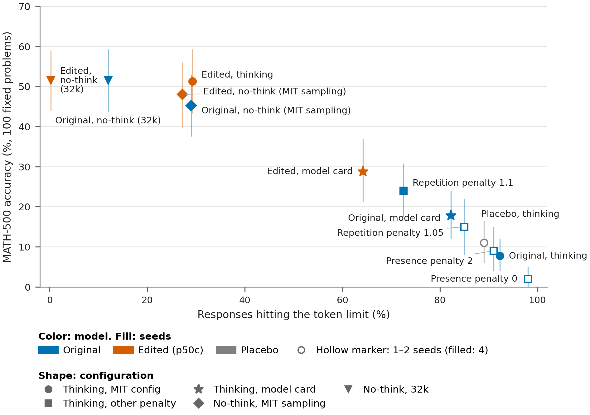
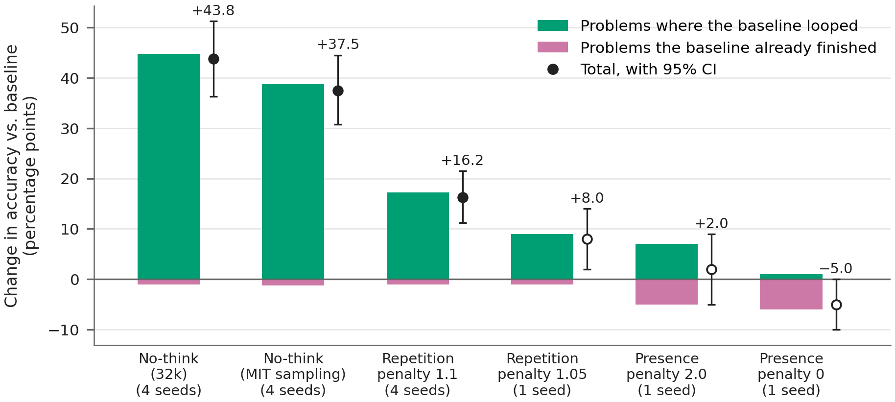
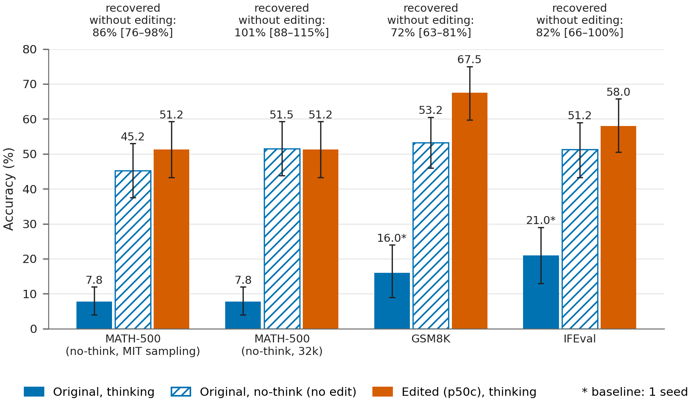
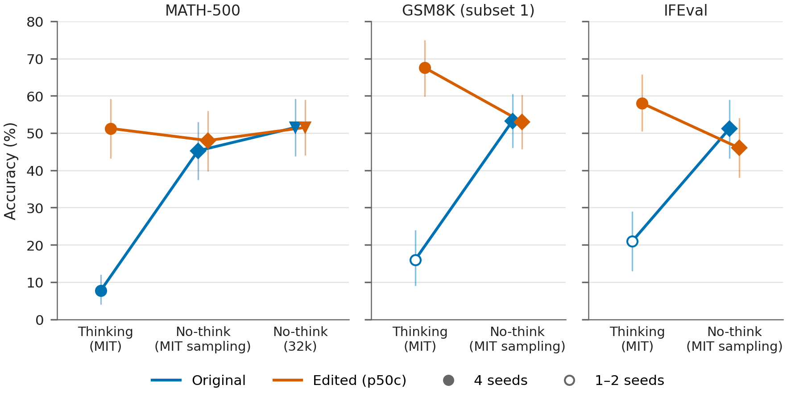
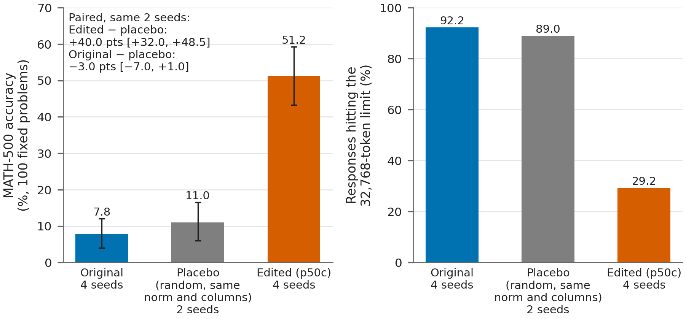
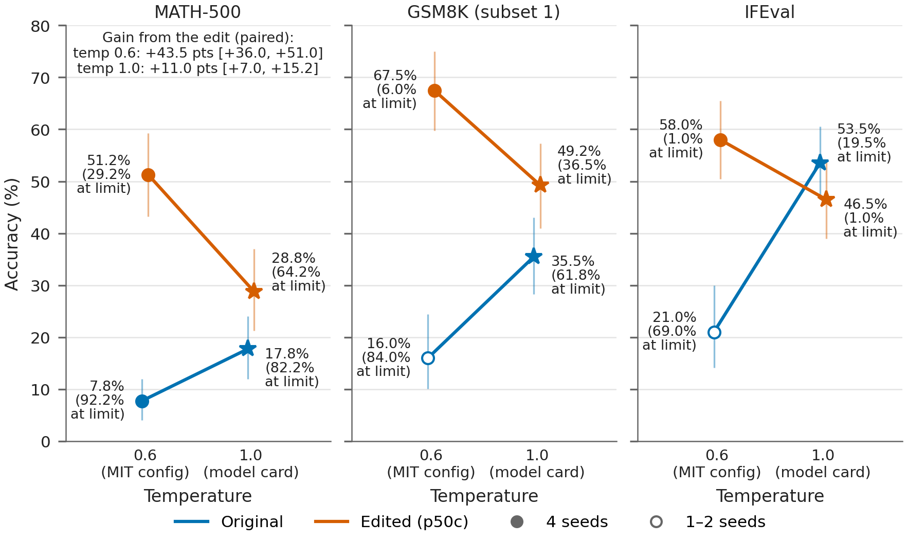
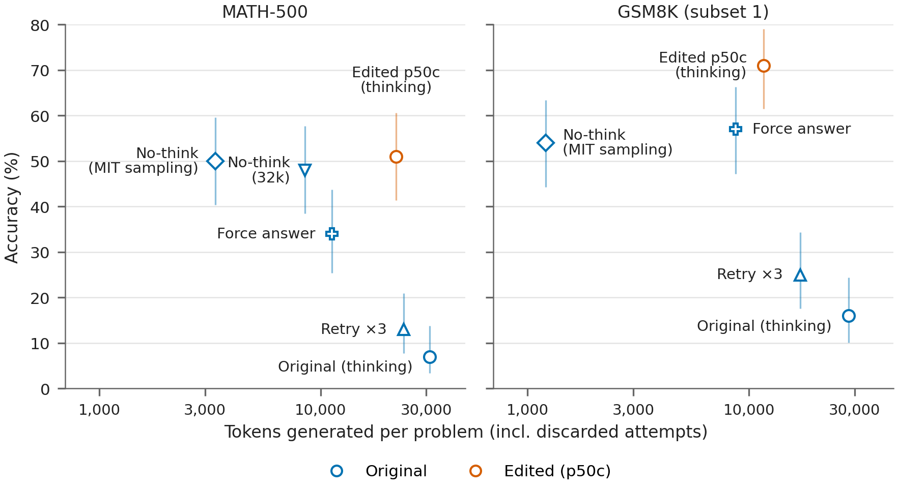

# Decomposing the Gain: How Much of a Weight-Space Edit's Fix for Reasoning Loops Do Cheap Baselines Recover?

**Juan José Giraldo Márquez**, independent researcher  
[github.com/JKUL-png](https://github.com/JKUL-png)

**Juan José Gómez**, undergraduate student in Data Engineering and Artificial Intelligence, Universidad Autónoma de Occidente (UAO), Cali, Colombia

Code and data: [github.com/JKUL-png/decomposing-the-gain](https://github.com/JKUL-png/decomposing-the-gain)

> Draft, 2026-11-05. Written so far: abstract and §1–§14 (full first draft). Every number carries an HTML comment with its source
> (`csv:` = file in `resultados/`; `data:` = fixed input file in `datos/`, not a result; `ext:` = number
> reported by the original authors, quoted for reference only).
> All model-card runs are in (4 seeds on MATH, GSM8K and IFEval).
> Rounding: exact halves round to even (51.25 → 51.2, 7.75 → 7.8), as in the `RESUMEN_*.md` files.

---

## Abstract

A recent blog post reported that a frontier LLM, by reading and editing the weights of Qwen3.5-0.8B, raised its MATH-500 accuracy from 7.9% to 48.1% (Takehi et al., 2026). The unedited model fails mostly because it loops in thinking mode until it hits the token limit. We ask how much of the edit's gain cheap alternatives recover without touching any weight. Under the original configuration we reproduce both endpoints: 7.8% unedited and 51.2% edited, on 100 fixed problems with four seeds. Turning thinking off recovers 86% of the edit's MATH gain under the original authors' no-thinking profile, 72% on GSM8K and 82% on IFEval. With a profile that keeps the full 32,768-token limit it ties the edit on MATH (51.5% vs 51.2%), and in that mode the edit adds nothing (51.5% vs 51.5%). The edit is still specific: a random edit with the same norm, tensors and columns scores 11.0%, and the real edit beats it by 40 points. Its gain depends on temperature. At the model card's recommended thinking configuration, which differs only in temperature (1.0 instead of 0.6), the MATH gain shrinks from 43.5 to 11.0 points because the edited model loops again. The GSM8K gain shrinks to 13.8 points, and on IFEval the unedited model ends 7.0 points above the edited one. At temperature 0.6 the edited thinking model keeps a residual advantage over the unedited model without thinking on GSM8K (+11.6 points) and, more weakly, on IFEval (+6.8); at temperature 1.0 that residual is gone. Cutting the loop and forcing an answer reaches 34% on MATH at about half the edited model's tokens. The edit works and is not a random perturbation, but most of what it buys a configuration change also buys, and the size of its benefit is tied to the sampling temperature at which it was found.
<!-- csv: tabla_r2_math_brazos.csv (7.8, 51.2); fraccion_ganancia.csv (86%, 72%, 82%); tabla_r2_math_brazos.csv (51.5, 51.5, 51.2); tabla_r2_mcnemar.csv (placebo +40.0; orig vs p50c no-think 32k dif 0.00); tabla_r3_mcnemar.csv (residual +11.625, +6.75); tabla_ficha_4sem_mcnemar.csv + tabla_r2_mcnemar.csv (43.5 → 11.0); tabla_ficha_otras_4sem_mcnemar.csv (+13.75, +7.0, residual −4.0 and −4.75); tabla_r3_reintento.csv (34%, tokens 11,268 vs 21,899). ext: takehi2026 (7.9 → 48.1) -->

---

## 1. Introduction

Weight-space programming is the idea that a language model can read a neural network's weights as text, work out what parts of it do, and edit them by reasoning, with no gradient descent (Takehi et al., 2026). Its most striking demonstration is on a small reasoning model. Qwen3.5-0.8B solves 7.9% of MATH-500 in thinking mode, and 93% of its responses run into the 32,768-token limit. After a frontier model (called Astra in the original post) edits two of its weight matrices, it solves 48.1% <!-- ext: takehi2026, exp8_math -->.

A jump from 7.9% to 48.1% invites a simple question: what exactly did the edit fix, and could something much cheaper have fixed it too? The Qwen3.5-0.8B model card already warns that the model "is more prone to entering thinking loops" in thinking mode, says it runs in non-thinking mode by default, and recommends detecting loops while streaming (Qwen Team, 2026). A public audit of the original logs found that the edit's whole gain comes from responses that used to hit the token limit (Messing, 2026). Neither observation says the edit is not real. Both suggest that much of its effect might be recoverable without editing anything.

We therefore **decompose** the gain instead of asking whether it is real. We take the original authors' published edit, rebuild it bit-for-bit, and set it against baselines that cost nothing to search for:
- single changes to the generation configuration;
- switching thinking off;
- the configuration the model card recommends;
- handling loops at inference time;
- a random edit of the same size placed in the same weights.

All arms are scored on the same fixed problems, with paired tests and the gain split by whether a response used to loop.

**Contributions.**
1. An exact-configuration replication of both the unedited and the edited model (§4).
2. A zero-edit arm: penalties and thinking-off, each changed alone (§5).
3. A 2×2 of edit × thinking on MATH, GSM8K (two disjoint subsets) and IFEval, with the fraction of the edit's gain recovered by thinking-off (§6).
4. A same-norm, same-location placebo edit (§7).
5. A test of both models at the temperature the model card recommends (§8).
6. Inference-time loop handling (retry, force answer) with every generated token counted (§9), and a cost comparison (§10).

**Findings.**
- **Thinking-off recovers most of the gain.** Turning thinking off, with no edit, recovers 86% of the edit's MATH gain under the original authors' no-thinking profile and ties the edit under the 32k profile (101%). Under the original profile it recovers 72% on GSM8K and 82% on IFEval (§6).
- **The edit's benefit depends on the sampling temperature.** At the model card's recommended thinking configuration (temperature 1.0 instead of 0.6) it falls from 43.5 to 11.0 points on MATH (§8). On GSM8K it shrinks to +13.8 points, and on IFEval it reverses, with the unedited model 7.0 points above the edited one.
- **The edit is specific.** The placebo does nothing, while the real edit is 40 points better (§7).
- **A residual remains at temperature 0.6.** The edit keeps an advantage over thinking-off on GSM8K and IFEval, which is the part of the original claim our cheap baselines do not explain (§6). At the model card's configuration that residual is gone (§8).

We also credit what the original work got right (§11). It published everything needed to check it, its result replicates, and the edit it found is small and meaningful. We list our own limitations in §12.

---

## 2. Background and related work

**Weight-space programming.** Takehi et al. describe experiments in which a frontier LLM reads the weights of small networks, infers what they were trained for, repairs failing ones, and writes new ones from scratch, without gradient-based training (Takehi et al., 2026). We study one of these experiments, the repair of Qwen3.5-0.8B's math reasoning ("Exp 8"). In that experiment, the editing model has access to the 0.8B model's weights in a Python kernel, a budget of forward passes, and a prompt asking it to make the model better at mathematics by editing its weights. The authors published the resulting edits for 10, 25 and 50 forward passes (`p10c`, `p25c`, `p50c`), the code to apply them, the sampling configuration and the full logs (RikiyaT, 2026). We study `p50c`, the edit behind the 48.1% figure.

**The model and its loops.** Qwen3.5-0.8B supports thinking and non-thinking modes and runs in non-thinking mode by default (Qwen Team, 2026). For thinking on text tasks, its model card recommends temperature 1.0, top_p 0.95, top_k 20, presence_penalty 1.5 and repetition_penalty 1.0. The original work used the same settings except for temperature 0.6. The card warns that the 0.8B model is prone to thinking loops, and suggests raising presence_penalty or detecting loops while streaming.

**A public audit of the logs.** Sol Messing audited the original logs and posted his findings publicly (Messing, 2026). By his account, the audit was done at least in part by asking Claude to review the logs. His thread is the origin of several controls in this paper, and we credit it here. For Exp 8 he reports that, on the editing model's own paired check over 1,152 held-out practice problems, the gain is +55.3 points among responses that originally hit the token limit and +0.0 among those that finished. He also notes that the editing prompt suggests looking for repetition, and he describes the fix as the ablation technique used to remove safety refusals. For other experiments he reports, among other things, that the car-control repair (Exp 4) inserts a hand-built controller that overrides the trained network (‖ΔW‖/‖W‖ = 25.7), and that game recognition (Exp 1) rests on first-layer weights that stay at their initial values for unused inputs. For Exp 4 he proposes running the same prompt on random or zeroed weights. <!-- ext: messing2026 -->

**What we add.** We build on that audit in four ways:
1. **A 2×2 of edit × thinking.** This separates what the edit does from what turning thinking off does, on MATH and on two benchmarks the audit did not examine, GSM8K and IFEval.
2. **A same-norm, same-location placebo edit on the real model.** For Qwen, this plays the role of his random-weights test. That test itself was proposed for Exp 4, which we do not rerun.
3. **Cheap baselines measured end to end.** These are single-parameter changes, thinking-off, the model card's configuration, and inference-time loop handling, with every token counted.
4. **His looping/finished split, measured on our own MATH-500 runs.** We report it separately and never merge it with his numbers, which come from a different problem set.

**Related ideas.**
- **Directional ablation:** some behaviors of language models, refusal in particular, are mediated by a single direction in activation space and can be removed with a rank-one weight edit (Arditi et al., 2024). `p50c` is effectively rank one, up to bfloat16 rounding, which fits this picture (§7) <!-- csv: ediciones_rango.csv -->.
- **Budget forcing:** ending a model's thinking by force, or extending it, is a simple way to control test-time compute (Muennighoff et al., 2025). Our "force answer" baseline (§9) uses the same idea to stop a loop.
- **Trained adapters:** parameter-efficient fine-tuning methods such as LoRA (Hu et al., 2022) are the natural trained baselines for weight edits. We leave them, and the task of teaching new knowledge, to future work.
- **Weight space learning:** a growing field treats the weights of trained networks as a data modality in their own right; a recent survey organizes it around understanding, representing and generating weights (Han et al., 2026).

**Benchmarks and tools.**
- **MATH-500:** the 500-problem subset of MATH (Hendrycks et al., 2021) used by Lightman et al. (2023).
- **GSM8K** (Cobbe et al., 2021) and **IFEval** (Zhou et al., 2023).
- **Tools:** generation with vLLM (Kwon et al., 2023), grading with math-verify (Kydlíček, 2026) and lm-eval's IFEval checker (Gao et al., 2023).
- **Statistics:** Wilson intervals (Wilson, 1927), exact McNemar tests (McNemar, 1947) with Holm correction (Holm, 1979), and a problem-level bootstrap (Efron, 1979).

---

## 3. Experimental setup

**Model and edit.** All experiments use Qwen3.5-0.8B at the revision the original authors started from <!-- data: scripts/mit_codigo/apply_edit.py, revision 2fc06364715b967f1860aea9cf38778875588b17 -->. We do not rerun weight-space programming. Instead, we rebuild the edited model the original work reports on MATH-500 (the `p50c` edit) from the published `edit.npz` and manifest, using the authors' own `apply_edit.py`. The rebuilt model passes the published hash check, so it is bit-identical to theirs. The edit changes two tensors, `mlp.down_proj` in layers 15 and 19, touching 64 columns in each <!-- csv: ediciones_norma.csv, columnas = 64 -->. Its relative size is ‖ΔW‖/‖W‖ = 0.106 in layer 15 and 0.081 in layer 19 <!-- csv: ediciones_norma.csv, cambio_relativo 0.106362 / 0.081063 -->.

**Placebo edit.** As a control for "any change of this size helps", we build a random edit with the same structure. It touches the same two tensors and the same 64 columns, and has the same norm per tensor <!-- csv: ediciones_norma.csv, placebo rows: norma_dW 1.74889 / 1.39876, identical to p50c -->, but its direction is random (built as rank one, fixed seed). The saved model differs from the base model in exactly those two tensors. Its results are in §7.

**Inference engine.** Generation uses vLLM 0.33.0 under WSL2 on a single 8 GB consumer GPU. Each configuration is run with a fixed seed per run. vLLM's sampler is run in its PyTorch implementation (`VLLM_USE_FLASHINFER_SAMPLER=0`), because the FlashInfer sampler requires a CUDA compiler that was not available. This is one known difference from the original setup (§12). We also note that vLLM sampling is not fully reproducible across batch compositions: rerunning the same 100 problems with the same seed in a different batch gave the same correct/incorrect outcome on 80 of 100 problems <!-- csv: tabla_dia_reproducibilidad.csv -->. For this reason we always compare runs at the level of the problem set and seeds, never token by token.

**Prompt and grading.** The MATH prompt is the original one: the problem, a newline, and "Please reason step by step, and put your final answer within \boxed{}." Answers are graded with math-verify 0.9.0, as in the original work. We take the last `\boxed{}` after `</think>` and test it with `verify(parse(gold), parse(pred))`. A response without a box is wrong. In thinking mode, a response that never closes `</think>` (because it hit the token limit) is wrong. In no-thinking mode we apply a **strict rule**: a response that hits the token limit counts as wrong even if it contains a correct box. The strict rule is the main number in every table; the more lenient rule is reported once, in §12. GSM8K uses the same prompt and grader as MATH. IFEval is graded with the official checker from lm-eval (prompt-level, strict). The original authors used a private module for IFEval, so our IFEval numbers are not directly comparable to theirs.

**Problem sets.** To fit the compute budget we evaluate on fixed subsets, chosen once before any run and never regenerated:
- MATH-500: 100 problems, stratified by difficulty level (8, 18, 21, 26 and 27 problems for levels 1–5; selection seed 20261103) <!-- data: datos/math500_subset100_ids.txt -->.
- GSM8K: two disjoint subsets of 100 problems each <!-- data: datos/gsm8k_subset100_ids.txt, datos/gsm8k_subset100b_ids.txt -->.
- IFEval: one subset of 100 prompts <!-- data: datos/ifeval_subset100_ids.txt -->.

All arms use exactly the same problems. The only exception is one no-thinking run on all 500 MATH-500 problems (§5). With 100 problems, a single run has a 95% interval about ±10 points wide near 50% accuracy (e.g. 51/100 → 41.3–60.6) <!-- csv: tabla_r2_corridas.csv, r2_ed_think seed 0: wilson 41.35–60.58 -->, so we avoid reading small differences.

**Generation configurations.** Table 1 lists every configuration used in the paper. Each arm changes one thing relative to the original authors' thinking configuration, which we take from their public logs.

**Table 1 — Generation configurations.**

| Name | Thinking | temperature | top_p | top_k | presence_penalty | repetition_penalty | max_tokens |
|---|---|---|---|---|---|---|---|
| Thinking, MIT (baseline) | on | 0.6 | 0.95 | 20 | 1.5 | 1.0 | 32,768 |
| No-thinking, MIT sampling | off | 0.7 | 0.8 | 20 | 1.5 | 1.0 | 8,192 |
| No-thinking, 32k | off | 0.6 | 0.95 | 20 | 1.5 | 1.0 | 32,768 |
| Qwen model-card thinking | on | 1.0 | 0.95 | 20 | 1.5 | 1.0 | 32,768 |
| Single-parameter variants | on | baseline, with one of: presence_penalty 0 or 2.0; repetition_penalty 1.05 or 1.1 | | | | | |

<!-- source: scripts/comun_math.py (BASE_MIT, NOTHINK_MIT, CERO_EDICION); every per-run CSV stores temperature, top_p, top_k, presence_penalty, repetition_penalty, max_tokens per row -->

Every per-run CSV records the sampling parameters next to each answer, so the configuration of any number can be checked against the raw output.

**Statistics.** For a single run we report a 95% Wilson interval. When we pool seeds, the four seeds of a problem are not independent samples, so pooled intervals and differences use a bootstrap that resamples *problems* (10,000 resamples, fixed seed). Paired comparisons between two arms use an exact two-sided McNemar test on the (problem, seed) pairs both arms share. *b* is the number of pairs where only A is correct, and *c* the number where only B is correct. p-values are corrected with Holm's method within each table. Because seeds of the same problem are correlated, McNemar p-values on pooled seeds are optimistic; the bootstrap interval of the difference is the more reliable measure of size.

---

## 4. Replication of the baseline and of the edit

We first check that our setup reproduces both endpoints of the original claim. Only then do we attribute the gain to its parts.

**Unedited model.** With the original thinking configuration, the unedited model solves 7.8% of our 100 problems, pooled over four seeds (bootstrap 95% CI 4.0–12.0) <!-- csv: tabla_r2_math_brazos.csv, orig · thinking MIT: precision_pct 7.75, boot 4.00–12.00 -->. 92.2% of its responses hit the 32,768-token limit <!-- csv: tabla_r2_math_brazos.csv, al_limite_pct 92.25 -->. Per seed, it solves 7, 9, 6 and 9 problems out of 100 <!-- csv: tabla_dia_corridas.csv, linea_base_vllm seeds 0–3 -->. The original work reports 7.9% on all 500 problems with four samples each, with 93% of responses hitting the limit <!-- ext: MIT exp8_math README / scores.json -->. Our estimate is consistent with theirs, though our interval is wider because we use a fifth of the problems.

The failure is almost entirely a looping failure. Every one of the 31 responses that finished on their own was correct <!-- csv: tabla_r2_math_brazos.csv, terminaron 31, correctos_terminaron 31 -->. None of the 369 responses that hit the limit was correct <!-- csv: tabla_dia_pareado_dos_grupos.csv, antes_limite_parejas 369, antes_limite_correctos_base 0 -->. When the unedited model stops, it is right; it rarely stops.

**Edited model.** With the same configuration, the rebuilt `p50c` model solves 51.2% (43.2–59.2), and 29.2% of its responses hit the limit <!-- csv: tabla_r2_math_brazos.csv, p50c · thinking MIT: precision_pct 51.25, boot 43.25–59.25, al_limite_pct 29.25 -->. Per seed, it solves 51, 51, 50 and 53 problems <!-- csv: tabla_r2_corridas.csv, r2_ed_think seeds 0–3 -->. The original work reports 48.1%, with 33.1% hitting the limit <!-- ext: MIT exp8_math -->. Our estimate again contains theirs.

The edit's gain over the unedited model is +43.5 points (bootstrap CI +36.0 to +51.0). It is entirely one-directional. Across 400 (problem, seed) pairs, there are 174 where only the edited model is correct and none where only the unedited model is correct (*b* = 0, *c* = 174; exact McNemar p = 8.4 × 10⁻⁵³) <!-- csv: tabla_r2_mcnemar.csv, orig · thinking MIT vs p50c · thinking MIT: b 0, c 174, dif −43.5, boot −51.0…−36.0, p 8.35e-53 -->. Among the edited model's responses that finished, 72.4% were correct (205 of 283) <!-- csv: tabla_r2_math_brazos.csv, terminaron 283, correctos_terminaron 205 -->. So the edit makes many more responses finish, but those additional responses are not all correct.

**Takeaway.** Under the original configuration we reproduce both the unedited accuracy and the edited accuracy within sampling error. The effect decomposed in the rest of the paper is the same effect the original work reported, not an artifact of a different setup.

---

## 5. Zero-edit arm: changing only the generation configuration

Before attributing anything to the weights, we ask how far the unedited model moves when only the generation configuration changes. Each variant changes one setting relative to the original thinking configuration (Table 1). All variants use the same 100 problems, and gains are measured against the baseline on the same seeds. The model card's configuration changes the temperature and was also run on the edited model, so it has its own section (§8).

### 5.1 Repetition and presence penalties

The obvious knobs against repetition help only modestly. The single-seed variants are:
- presence_penalty 0: 2.0% (bootstrap CI 0.0–5.0);
- presence_penalty 2.0: 9.0% (4.0–15.0);
- repetition_penalty 1.05: 15.0% (8.0–22.0).
<!-- csv: tabla_dia_promedios.csv, cero_edicion_presence0 / presence2 / rep105, seed 0 -->

repetition_penalty 1.1, run with four seeds, reaches 24.0% (17.5–30.8). Even so, 72.5% of its responses still hit the limit <!-- csv: tabla_dia_promedios.csv, cero_edicion_rep110: 24.00, boot 17.50–30.75, al_limite 72.50 -->. Against the baseline on the same seeds, rep 1.1 gains +16.2 points (CI +11.2 to +21.5). That is +17.2 points from responses that used to loop and −1.0 from responses that already finished <!-- csv: tabla_dia_pareado_dos_grupos.csv, cero_edicion_rep110: dif_total 16.25, boot 11.25…21.50, antes_limite +17.25, ya_terminaban −1.0 -->. MIT's own presence_penalty of 1.5 matters: removing it lowers accuracy by 5.0 points (CI −10.0 to 0.0). Most of that loss (−6.0) is in responses that finished at 1.5 <!-- csv: tabla_dia_pareado_dos_grupos.csv, cero_edicion_presence0: dif −5.0, boot −10.0…0.0, ya_terminaban −6.0 -->.

### 5.2 Turning thinking off

Switching thinking off moves accuracy as much as the edit does. With the thinking sampling and the full 32,768-token limit, the unedited model scores 51.5% (43.8–59.2), and only 12.0% of its responses hit the limit. With the original authors' no-thinking profile (8,192 tokens), it scores 45.2% (37.5–53.0), with 29.0% at the limit <!-- csv: tabla_r2_math_brazos.csv, orig · no-think 32k: 51.50, boot 43.75–59.25, al_limite 12.00; orig · no-think muestreo MIT: 45.25, boot 37.50–53.00, al_limite 29.00 -->. Figure 1 places every MATH-500 configuration on one plot. Accuracy rises as fewer responses hit the limit, but it stops rising once that share is below about 30%.

**Figure 1 — Accuracy against the share of responses that hit the token limit (MATH-500).** Each point is one configuration on the same 100 fixed problems. Color marks the model and shape marks how it is run. Filled markers use 4 seeds; hollow markers use 1 or 2. Bars are bootstrap intervals. The limit is 32,768 tokens, except for the two "MIT sampling" no-think arms, whose limit is 8,192.

We also ran both profiles on all 500 MATH-500 problems with one seed. The results are 49.4% (Wilson 45.0–53.8) at 32k and 44.8% (40.5–49.2) with the original no-thinking profile <!-- csv: tabla_r2_math500_nothink32k.csv, TODOS: 49.40, wilson 45.04–53.77; tabla_dia_math500_nothinkmit.csv, TODOS: 44.80, wilson 40.50–49.18 -->. For reference, the original work reports 48.1% for the *edited* model in thinking mode on the same 500 problems <!-- ext: MIT exp8_math -->. These are different conditions and different sample sizes, so we do not test the difference. We only note that the unedited model without thinking lands in the same range.

The gain from thinking-off is where Messing's audit says the edit's gain is: in responses that used to loop. Against the baseline on the same four seeds, thinking-off at 32k gains +43.8 points (CI +36.2 to +51.2). Of the 369 (problem, seed) pairs where the baseline hit the limit, thinking-off cut the loop in 321 and answered 179 correctly, for +44.8 points. Of the 31 pairs where the baseline had finished, it lost 4 and gained none, for −1.0 point <!-- csv: tabla_dia_pareado_dos_grupos.csv, cero_edicion_no_thinking: dif 43.75, boot 36.25…51.25; antes_limite 369 parejas, corto_bucle 321, correctos_variante 179, contribución +44.75; ya_terminaban 31, perdidos 4, ganados 0, contribución −1.0 -->. Messing reported the same pattern for the edit itself. On the editing model's own paired check over 1,152 held-out practice problems in the original logs, the edit gained +55.3 points where the unedited answer had hit the limit and +0.0 where it had finished <!-- ext: messing2026 -->. His problems are not MATH-500, so we do not compare the two splits numerically. We only note that thinking-off and the edit both act on the same group of responses. Figure 2 shows the same split for every variant in this section.

**Figure 2 — Where the gain of each no-edit variant comes from (MATH-500).** Change in accuracy against the baseline (original model, MIT thinking configuration), split into problems where the baseline hit the limit and problems it already finished. The two segments add up to the total. Totals are paired on the seeds each variant shares with the baseline (shown under each label), on 100 problems. Bars are bootstrap intervals of the total.

---

## 6. Decomposing the edit's gain: a 2×2 of edit × thinking

The unedited model fails because it loops in thinking mode, and the edit makes it loop less. That raises an obvious question: how much of the edit's effect could we get by simply not thinking? We cross the two factors, edit (unedited / `p50c`) and mode (thinking / no-thinking), and run each cell with the same 100 problems and four seeds. No-thinking is run with two sampling profiles. The first is the original authors' own no-thinking profile (8,192 tokens). The second is the thinking-mode sampling with thinking switched off and the full 32,768-token limit (Table 1).

**Table 2 — MATH-500 (100 fixed problems, 4 seeds; placebo 2 seeds).**

| Model | Mode | Accuracy % (bootstrap 95% CI) | Hit limit % | Correct among finished | Mean tokens |
|---|---|---|---|---|---|
| unedited | thinking | 7.8 (4.0–12.0) | 92.2 | 31/31 | 30,770 |
| unedited | no-think, MIT sampling | 45.2 (37.5–53.0) | 29.0 | 181/284 | 3,388 |
| unedited | no-think, 32k | 51.5 (43.8–59.2) | 12.0 | 206/352 | 7,955 |
| `p50c` | thinking | 51.2 (43.2–59.2) | 29.2 | 205/283 | 21,436 |
| `p50c` | no-think, MIT sampling | 48.0 (39.8–56.0) | 27.2 | 192/291 | 3,482 |
| `p50c` | no-think, 32k | 51.5 (44.0–59.0) | 0.2 | 206/399 | 6,403 |
| placebo | thinking | 11.0 (6.0–16.5) | 89.0 | 22/22 | 29,899 |

<!-- csv: tabla_r2_math_brazos.csv (precision_pct, precision_boot_lo/hi, al_limite_pct, correctos_terminaron/terminaron, tokens_medios); values rounded to 1 decimal / integer tokens -->

**On MATH, with the 32k profile, thinking-off ties the edit.** The unedited model with thinking off at 32k scores 51.5%, the same as the edited model in thinking (51.2%). The paired difference is +0.2 points (bootstrap CI −5.5 to +6.0), with 51 pairs where only the edited model is right and 50 where only the unedited no-thinking model is right (exact McNemar p = 1) <!-- csv: tabla_r2_mcnemar.csv, orig · no-think 32k vs p50c · thinking MIT: dif +0.25, boot −5.50…+6.00, b 51, c 50, p 1.0 -->. With the original authors' no-thinking profile, the unedited model is 6.0 points below the edited model (CI 1.0 to 11.0). This difference is not significant after Holm correction over the 55 comparisons in the table (p = 0.017 unadjusted, 0.32 adjusted) <!-- csv: tabla_r2_mcnemar.csv, orig · no-think muestreo MIT vs p50c · thinking MIT: dif −6.00, boot −11.00…−1.00, p 0.017, p_holm 0.32; 55 rows in the MATH family -->. In no-thinking mode the edit adds nothing: at 32k both models score 51.5% (difference 0.0, CI −6.0 to +6.0, p = 1) <!-- csv: tabla_r2_mcnemar.csv, orig · no-think 32k vs p50c · no-think 32k: dif 0.00, boot −6.00…+6.00, b 59, c 59, p 1.0 -->.

The two routes reach the same accuracy in different ways. The edited model in thinking finishes fewer responses (283 of 400), but more of them are correct (72.4%). The unedited model without thinking finishes more (352 of 400), with 58.5% correct <!-- csv: tabla_r2_math_brazos.csv, precision_terminaron_pct 72.44 (205/283) and 58.52 (206/352) -->. These two percentages describe different populations of problems: each arm finishes a different set of responses, and an arm that finishes fewer may be finishing easier problems. The comparison is not paired, so it does not show that the edited model's reasoning is better. What we can say is that the edit is not simply "thinking off", because it keeps the reasoning. On MATH the net result is the same.

**Recovered fraction.** We summarize each benchmark with the fraction of the edit's gain that thinking-off recovers: (NT − OT) / (ED − OT). Here OT is the unedited model in thinking, ED the edited model in thinking, and NT the unedited model without thinking. Intervals come from the problem-level bootstrap.

| Benchmark (100 problems) | OT % | NT % | ED % | Recovered fraction (95% CI) |
|---|---|---|---|---|
| MATH-500, no-think MIT sampling | 7.8 | 45.2 | 51.2 | 86% (76–98%) |
| MATH-500, no-think 32k | 7.8 | 51.5 | 51.2 | 101% (88–115%) |
| GSM8K subset 1, no-think MIT sampling | 16.0 | 53.2 | 67.5 | 72% (63–81%) |
| IFEval, no-think MIT sampling | 21.0 | 51.2 | 58.0 | 82% (66–100%) |

<!-- csv: fraccion_ganancia.csv (OT, NT, ED, fraccion, fraccion_ic_lo/hi). OT has seed 0 only on GSM8K and IFEval (column semillas_OT); all other cells seeds 0–3 -->

A fraction above 100% only means that, within noise, thinking-off does at least as well as the edit. On GSM8K and IFEval the unedited thinking baseline was run with one seed only, so those two fractions have a noisier starting point (§12). Figure 3 shows each fraction with the three accuracies behind it.

**Figure 3 — How much of the edit's gain is recovered by switching thinking off.** Accuracy of the original model with thinking, the original model without thinking (no edit), and the edited model with thinking, on 100 problems per benchmark. Bars are bootstrap intervals of each arm's accuracy. "Recovered" is the no-think gain divided by the edit's gain, with its bootstrap interval. No-think and edited arms use 4 seeds. The baseline uses 4 seeds on MATH-500 and 1 seed on GSM8K and IFEval (asterisk).

**On GSM8K and IFEval, a residual remains.** Outside MATH the edited model in thinking keeps a real advantage over the unedited model without thinking. Because GSM8K subset 1 showed this first, we confirmed it on a second, disjoint subset of 100 GSM8K problems drawn after seeing the first result.

**Table 3 — GSM8K and IFEval (100 problems per subset, 4 seeds).**

| Benchmark | `p50c` thinking % | `p50c` no-think % | unedited no-think % | `p50c` thinking − unedited no-think, pts (CI) | p Holm |
|---|---|---|---|---|---|
| GSM8K subset 1 | 67.5 | 53.0 | 53.2 | +14.2 (+9.0…+19.5) | 1.2 × 10⁻⁷ |
| GSM8K subset b | 65.8 | 55.8 | 56.8 | +9.0 (+3.0…+15.5) | 0.0014 |
| GSM8K pooled (200) | 66.6 | 54.4 | 55.0 | +11.6 (+7.6…+15.8) | 3.7 × 10⁻¹⁰ |
| IFEval | 58.0 | 46.0 | 51.2 | +6.8 (+0.0…+13.5) | 0.048 |

<!-- csv: tabla_r3_brazos.csv (precision_pct per arm and table); tabla_r3_mcnemar.csv rows "p50c · thinking MIT vs orig · no-think muestreo MIT": sub.1 +14.25 (9.0…19.5) holm 1.2e-07; sub.b +9.0 (3.0…15.5) holm 0.0014; pooled +11.625 (7.625…15.75), b 154, c 61, holm 3.7e-10; IFEval +6.75 (0.0…13.5) holm 0.048. No-think = MIT sampling (8,192) -->

On GSM8K the residual replicates on both subsets. Pooled over 200 problems it is +11.6 points, with 154 pairs where only the edited thinking model is right against 61 where only the unedited no-thinking model is right <!-- csv: tabla_r3_mcnemar.csv, GSM8K 1 + b juntos: b 154, c 61 -->. On IFEval the residual is smaller (+6.8). Its interval touches zero, so we read it as weak evidence.

This residual belongs to the edit combined with thinking, not to the edit alone. In no-thinking mode the edited model is no better than the unedited one: −0.6 points on pooled GSM8K (p = 0.78) <!-- csv: tabla_r3_mcnemar.csv, GSM8K 1 + b juntos, p50c no-think vs orig no-think: dif −0.625, boot −4.625…+3.125, p_holm 0.78 -->. On IFEval it is slightly worse: −5.2 points (CI −10.0 to −0.8, p Holm 0.048) <!-- csv: tabla_r3_mcnemar.csv, IFEval, p50c no-think vs orig no-think: dif −5.25, boot −10.0…−0.75, p_holm 0.048 -->. The edit therefore seems to do two things. It reduces looping, which thinking-off also achieves. It also leaves the thinking itself somewhat more useful on GSM8K, and perhaps on IFEval, which thinking-off does not reproduce. The second effect is the part of the original claim that our cheap baselines do not explain at temperature 0.6. At the model-card configuration it is gone on both benchmarks (§8). Figure 4 shows the 2×2 on the three benchmarks.

**Figure 4 — Edit × thinking.** Accuracy of the original and edited models in each mode, on 100 problems per benchmark. The 32k no-think profile was run on MATH-500 only. Points use 4 seeds, except the original model with thinking on GSM8K and IFEval (hollow, 1 seed). Bars are bootstrap intervals.

---

## 7. Is the edit specific? Placebo control and edit size

The edit is small, so a fair question is whether *any* perturbation of that size, in those places, would break the loops. The placebo (§3) answers this. It touches the same tensors and columns with the same per-tensor norm, but in a random direction.

**Table 4 — Edit size.**

| Tensor | Edit | ‖ΔW‖_F | ‖W‖_F | ‖ΔW‖/‖W‖ | Columns touched |
|---|---|---|---|---|---|
| layer 15 `mlp.down_proj` | `p50c` | 1.749 | 16.443 | 0.106 | 64 |
| layer 15 `mlp.down_proj` | placebo | 1.749 | 16.443 | 0.106 | 64 |
| layer 19 `mlp.down_proj` | `p50c` | 1.399 | 17.255 | 0.081 | 64 |
| layer 19 `mlp.down_proj` | placebo | 1.399 | 17.255 | 0.081 | 64 |

<!-- csv: ediciones_norma.csv (norma_dW, norma_W, cambio_relativo, columnas), rounded to 3 decimals -->

**Rank.** A singular value decomposition of ΔW finds 64 singular values above numerical tolerance in each tensor, so its strict rank is 64, not 1. In practice it is rank one. The largest singular value carries 99.9995% of the squared norm in layer 15 and 99.9991% in layer 19, and the second is 0.06% of the first <!-- csv: ediciones_rango.csv, p50c_MIT: rango_numerico 64, energia_sv1 0.999995 / 0.999991, sv2_sobre_sv1 0.000565 / 0.000644 -->. The placebo, built as exactly rank one before rounding to bfloat16, looks the same: strict rank 64, with a second singular value 0.06–0.07% of the first <!-- csv: ediciones_rango.csv, placebo: rango_numerico 64, sv2_sobre_sv1 0.000595 / 0.000686 -->. The small singular values are therefore what bfloat16 rounding alone produces. We call `p50c` effectively rank one, and the placebo matches it in this respect too.

The placebo leaves the model essentially unchanged. In thinking mode it scores 11.0% (6.0–16.5), and 89.0% of its responses still hit the limit <!-- csv: tabla_r2_math_brazos.csv, placebo · thinking MIT: 11.00, boot 6.00–16.50, al_limite 89.0, seeds 0 1 -->. Against the unedited model on the same two seeds, there are 6 pairs where only the unedited model is right and 12 where only the placebo is right (p = 0.24; p = 1 after Holm) <!-- csv: tabla_r2_mcnemar.csv, orig · thinking MIT vs placebo · thinking MIT: parejas 200, b 6, c 12, p 0.238, p_holm 1.0 -->. Against the real edit, the placebo is 40.0 points lower (CI 32.0 to 48.5). There are 80 pairs where only the real edit is right and none where only the placebo is (p = 1.7 × 10⁻²⁴) <!-- csv: tabla_r2_mcnemar.csv, p50c · thinking MIT vs placebo · thinking MIT: dif +40.0, boot +32.0…+48.5, b 80, c 0, p 1.7e-24 -->. Figure 5 compares the three models.

**Figure 5 — Placebo edit against the real edit (MATH-500, MIT thinking configuration).** Left: accuracy, with bootstrap intervals. Right: share of responses that hit the 32,768-token limit. The placebo is a single random direction with the same norm as the real edit, in the same two tensors and the same 64 columns per tensor; both edits are effectively rank one. It was run with 2 seeds; the other two arms use 4. Paired differences use only the 2 seeds all three share, so they do not equal the difference between bar heights.

So the effect does not come from the size or the location of the change alone. Its direction matters. A change of 8–11% of the norm in two tensors fixes most of the looping when it points the right way, and does almost nothing when it points at random. This is the strongest point in favor of the original work, and we return to it in §11. The placebo is limited to two seeds, MATH only, and one kind of random direction (§12).

---

## 8. Sensitivity to sampling temperature

All thinking-mode results so far use the original temperature of 0.6. Here we change that one setting and test one alternative value, the one the model's developers recommend.

The Qwen3.5-0.8B model card recommends a specific thinking-mode sampling for text tasks. It is the original configuration with one change: temperature 1.0 instead of 0.6 <!-- data: Qwen/Qwen3.5-0.8B model card, text-task thinking profile: temperature 1.0, top_p 0.95, top_k 20, presence_penalty 1.5, repetition_penalty 1.0 -->. (The card also lists a temperature-0.6 profile, but for vision and precise coding tasks, with presence_penalty 0. That is not the configuration used by the original work.) Because this is the configuration a user of the model is told to use, we ran it on both the unedited and the edited model, with four seeds.

**Table 5 — Model-card thinking configuration vs. the original configuration (MATH-500, 100 problems, 4 seeds).**

| Model | temp 0.6 (original config) | temp 1.0 (model card) | Hit limit at temp 1.0 | Difference (CI) | b / c | p Holm |
|---|---|---|---|---|---|---|
| unedited | 7.8 | 17.8 (12.0–24.0) | 82.2% | +10.0 (+5.2…+15.0) | 53 / 13 | 7.2 × 10⁻⁷ |
| `p50c` | 51.2 | 28.8 (21.2–37.0) | 64.2% | −22.5 (−28.5…−16.8) | 6 / 96 | 1.7 × 10⁻²¹ |

<!-- csv: tabla_ficha_4sem_corridas.csv (precision_pct, ic_lo/hi bootstrap, al_limite_pct, rows semilla "0 1 2 3"); tabla_ficha_4sem_mcnemar.csv (dif, boot, b, c, p_holm; A = temp 1.0, B = temp 0.6, b = only temp 1.0 correct). temp-0.6 accuracies from tabla_r2_math_brazos.csv -->

The recommended configuration helps the unedited model a little. Its +10.0 points come from responses that used to loop (+13.2), partly offset by −3.2 in responses that already finished <!-- csv: tabla_ficha_4sem_dos_grupos.csv, orig ficha vs orig 0.6: B_al_limite +13.25, B_termino −3.25 -->. It hurts the edited model a lot. The edited model loses 22.5 points, and almost all of that loss (−23.5) is in responses that finished at temperature 0.6. At temperature 1.0 the edited model loops again, with 64.2% of responses at the limit, against 29.2% at 0.6 <!-- csv: tabla_ficha_4sem_dos_grupos.csv, p50c ficha vs p50c 0.6: B_al_limite +1.0, B_termino −23.5; tabla_ficha_4sem_corridas.csv al_limite_pct 64.25; tabla_r2_math_brazos.csv al_limite_pct 29.25 -->. The drop is stable across seeds: 28, 28, 31 and 28 correct out of 100 <!-- csv: tabla_ficha_4sem_corridas.csv, r2_ed_ficha_qwen seeds 0–3 -->.

Under the model-card configuration, the edit is still better than no edit, but by much less. It gains +11.0 points (CI +7.0 to +15.2; 53 pairs where only the edited model is right, 9 the other way; p Holm 2.1 × 10⁻⁸) <!-- csv: tabla_ficha_4sem_mcnemar.csv, orig ficha vs p50c ficha: dif −11.0, boot −15.25…−7.0, b 9, c 53, p_holm 2.1e-08 -->. Under the original configuration the gain is +43.5 points (§4). So the size of the edit's benefit depends strongly on the sampling temperature it is evaluated at. The edit was found and reported at temperature 0.6, and its effect does not carry over at full strength to the temperature the model's developers recommend. This does not make the edit wrong. It does mean that "7.9% → 48.1%" describes one configuration, not the model.

**GSM8K and IFEval.** We repeated the comparison on GSM8K subset 1 and IFEval with four seeds. The pattern holds on GSM8K and goes further on IFEval.

**Table 6 — Model-card configuration on GSM8K subset 1 and IFEval (100 problems each, 4 seeds).**

| Benchmark | Model | temp 0.6 | temp 1.0 (model card) | Difference, pts (CI) | b / c | p Holm |
|---|---|---|---|---|---|---|
| GSM8K | unedited | 16.0* | 35.5 (28.2–43.0) | +19.0* (+11.0…+28.0) | 21 / 2 | 0.00013 |
| GSM8K | `p50c` | 67.5 | 49.2 (41.0–57.2) | −18.2 (−23.8…−12.8) | 16 / 89 | 7.5 × 10⁻¹³ |
| IFEval | unedited | 21.0* | 53.5 (46.5–60.5) | +37.0* (+25.0…+48.0) | 43 / 6 | 2.3 × 10⁻⁷ |
| IFEval | `p50c` | 58.0 | 46.5 (39.0–54.2) | −11.5 (−17.5…−5.8) | 38 / 84 | 0.00011 |

\* The unedited model at temperature 0.6 was run with seed 0 only. Its difference, b / c and p compare seed 0 at both temperatures (35.0 vs 16.0 on GSM8K, 58.0 vs 21.0 on IFEval), so they are not the difference of the two columns.

<!-- csv: tabla_ficha_otras_4sem_corridas.csv (precision_pct, ic_lo/hi; rows semilla "0 1 2 3", orig temp 0.6 row semilla 0); tabla_ficha_otras_4sem_mcnemar.csv (A = temp 1.0, B = temp 0.6; b = only temp 1.0 correct; Holm within the 4 comparisons of each benchmark; orig rows have 100 pairs, seed 0) -->

On GSM8K the edited model's drop comes with looping, as on MATH: 36.5% of its responses hit the limit, against 6.0% at temperature 0.6. On IFEval it does not: 1.0% hit the limit at both temperatures, so looping does not explain that drop <!-- csv: tabla_ficha_otras_4sem_corridas.csv, p50c rows semilla "0 1 2 3", al_limite_pct: GSM8K 36.5 / 6.0, IFEval 1.0 / 1.0 -->.

At the model-card configuration, the edit's advantage over no edit shrinks on GSM8K and reverses on IFEval:
- **GSM8K:** +13.8 points (CI +7.8 to +19.8; 82 pairs where only the edited model is right against 27; p Holm 3.8 × 10⁻⁷) <!-- csv: tabla_ficha_otras_4sem_mcnemar.csv, GSM8K, orig ficha vs p50c ficha: dif −13.75, boot −19.75…−7.75, b 27, c 82, p_holm 3.8e-07 -->. At temperature 0.6 it is +55.0, on seed 0, the only seed the unedited model has there <!-- csv: tabla_r3_mcnemar.csv, GSM8K subconjunto 1, p50c · thinking MIT vs orig · thinking MIT (solo semilla 0): dif +55.0 -->. On that same seed the model-card gain is +20.0 <!-- csv: tabla_ficha_otras_mcnemar.csv, GSM8K, orig ficha vs p50c ficha: dif −20.0 -->.
- **IFEval:** the unedited model is now 7.0 points *above* the edited one (CI +0.2 to +13.8; 83 pairs where only the unedited model is right against 55; p Holm 0.042) <!-- csv: tabla_ficha_otras_4sem_mcnemar.csv, IFEval, orig ficha vs p50c ficha: dif +7.0, boot +0.25…+13.75, b 83, c 55, p_holm 0.042 -->. The interval nearly touches zero and p-values on pooled seeds are optimistic (§3), so we read this as weak evidence that the edit hurts at this temperature, and firmer evidence that its advantage is gone. At temperature 0.6, on seed 0, the edit is +37.0 <!-- csv: tabla_r3_mcnemar.csv, IFEval, p50c · thinking MIT vs orig · thinking MIT (solo semilla 0): dif +37.0 -->.

The same runs also bear on the residual advantage of §6. At temperature 0.6, the edited thinking model beat the unedited model without thinking on GSM8K and IFEval. At the model-card configuration it no longer does: −4.0 points on GSM8K (CI −10.5 to +2.5, p Holm 0.17) and −4.8 on IFEval (CI −12.2 to +2.5, p Holm 0.12) <!-- csv: tabla_ficha_otras_4sem_mcnemar.csv, p50c ficha vs orig · no-think muestreo MIT: GSM8K dif −4.0, boot −10.5…+2.5, b 52, c 68, p_holm 0.17; IFEval dif −4.75, boot −12.25…+2.5, b 58, c 77, p_holm 0.12 -->. Neither difference is significant. This points the same way as MATH: much of what the edit adds over cheap baselines is tied to the temperature it was evaluated at. Figure 6 shows both temperatures on the three benchmarks.

**Figure 6 — Sensitivity to sampling temperature.** Accuracy of the original and edited models at temperature 0.6 (MIT configuration) and 1.0 (model card), with the share of responses at the token limit in parentheses. These are two configurations, not a sweep. MATH-500: 100 problems, 4 seeds, bootstrap intervals; the gain is paired, with its bootstrap interval. GSM8K and IFEval: 100 problems, 4 seeds, bootstrap intervals, except the original model at temperature 0.6 (seed 0 only, Wilson interval, hollow marker).

---

## 9. Inference-time loop handling (no weights changed, thinking kept)

Thinking-off removes the loops, but it also removes the thinking. A second cheap baseline keeps thinking on and handles loops at inference time, as the Qwen model card itself recommends. We stream each response and check it for repetition every 512 tokens. A loop is declared when the last 300 characters appear at least 3 times in the last 6,000 characters. On saved responses of the unedited model, this rule catches 358 of the 369 responses that hit the limit on MATH, and never fires on the 31 that finish <!-- csv: calibracion_detector_bucle.csv, MATH original thinking: detectadas 358 / llegaron_limite 369, falsos_positivos 0 / terminaron 31 -->. When the detector fires we take one of two actions:

- **A (retry):** abort and sample again with a new seed, up to 3 attempts in total.
- **B (force answer):** cut the response at the first copy of the repeated text, close the reasoning with `</think>`, and let the model answer within at most 4,096 tokens. If the answer does not close within the cap, it counts as wrong.

Both variants share the first attempt, are run on the unedited model with seed 0, and are compared with the edited model on the same seed. Every token generated is counted, including discarded attempts.

**Table 7 — Loop handling, seed 0 (MATH-500 100 problems; GSM8K subset 1).**

| Task | Arm | Accuracy % (Wilson 95%) | Forced (cap hit) | Mean attempts | Tokens per problem |
|---|---|---|---|---|---|
| MATH | unedited thinking | 7.0 (3.4–13.7) | — | 1.00 | 31,039 |
| MATH | A · retry | 13.0 (7.8–21.0) | — | 2.69 | 23,773 |
| MATH | B · force answer | 34.0 (25.5–43.7) | 87 (62) | 1.00 | 11,268 |
| MATH | `p50c` thinking | 51.0 (41.3–60.6) | — | 1.00 | 21,899 |
| GSM8K | unedited thinking | 16.0 (10.1–24.4) | — | 1.00 | 28,145 |
| GSM8K | A · retry | 25.0 (17.5–34.3) | — | 2.66 | 17,016 |
| GSM8K | B · force answer | 57.0 (47.2–66.3) | 87 (36) | 1.00 | 8,698 |
| GSM8K | `p50c` thinking | 71.0 (61.5–79.0) | — | 1.00 | 11,672 |

<!-- csv: tabla_r3_reintento.csv (precision_pct, precision_wilson_lo/hi, forzados, forzados_tope_sin_cerrar, intentos_medios, tokens_totales_por_problema) -->

**Retrying helps little.** Most problems use up all three attempts: on MATH, 13 problems needed 1 attempt, 5 needed 2 and 82 needed 3 <!-- csv: tabla_r3_intentos.csv, MATH: 13 / 5 / 82 -->. A new sample tends to loop again. On MATH, retry is 6.0 points above the plain baseline (8 pairs against 2; p = 0.11), and on GSM8K 9.0 points above (p = 0.064). Neither difference is significant <!-- csv: tabla_r3_mcnemar.csv, A · reintento vs orig · thinking (ref.): MATH dif +6.0, b 8, c 2, p_holm 0.109; GSM8K dif +9.0, p_holm 0.064 -->.

**Forcing an answer helps a lot, at the lowest cost.** B raises MATH from 7.0% to 34.0%. It is never worse than the plain baseline on any problem: 27 pairs where only B is right, none the other way (p Holm 6 × 10⁻⁸) <!-- csv: tabla_r3_mcnemar.csv, B · forzar vs orig · thinking (ref.), MATH: dif +27.0, b 27, c 0, p_holm 6.0e-08 -->. On GSM8K it goes from 16.0% to 57.0% (+41.0 points, p Holm 2.4 × 10⁻¹⁰) <!-- csv: tabla_r3_mcnemar.csv, GSM8K: dif +41.0, b 43, c 2, p_holm 2.4e-10 -->. It does this with the fewest tokens of any thinking-mode arm: 11,268 tokens per problem on MATH and 8,698 on GSM8K, about half the edited model's 21,899 and 11,672 <!-- csv: tabla_r3_reintento.csv, tokens_totales_por_problema -->.

**But it stays below the edit.** B is 17.0 points below the edited model on MATH (CI 8.0 to 26.0, p Holm 0.0018), and 14.0 below on GSM8K (CI 4.0 to 24.0, p Holm 0.025) <!-- csv: tabla_r3_mcnemar.csv, B · forzar vs p50c · thinking: MATH dif −17.0, boot −26.0…−8.0, b 4, c 21, p_holm 0.0018; GSM8K dif −14.0, boot −24.0…−4.0, b 7, c 21, p_holm 0.025 -->. Part of this gap is our own design choice. Of the 87 forced answers, 62 on MATH and 36 on GSM8K did not close within the 4,096-token cap and were counted wrong <!-- csv: tabla_r3_reintento.csv, forzados 87, forzados_tope_sin_cerrar 62 (MATH) / 36 (GSM8K) -->. B is therefore a lower bound on what forced answering can do. Figure 7 plots accuracy against tokens for every arm.

**Figure 7 — Accuracy against token cost.** Each point is one way of handling the loops, on 100 problems. All points are from seed 0. The retry and force-answer arms were run on seed 0 only, so every other arm is shown at the same seed to compare them under the same conditions. Values can therefore differ from the 4-seed means elsewhere in the paper. Tokens per problem include discarded attempts, and the x axis is logarithmic. Bars are Wilson intervals. All arms use the original model except the one marked as edited. The 32k no-think profile was run on MATH-500 only.

We did not give the edited model the same loop handling. On the edited model's saved MATH responses, the detector fires on 56 of the 283 responses that do finish on their own <!-- csv: calibracion_detector_bucle.csv, MATH p50c thinking: falsos_positivos 56 / terminaron 283 -->, so applying it would cut off correct reasoning. The comparison in Table 7 is thus asymmetric: unedited model with loop handling against edited model without. All of this is a single seed.

---

## 10. Cost

All runs used one consumer GPU (8 GB). The cheapest way to stop the loops is also the cheapest to run (Figure 7).

**Table 8 — Cost per response and per run, MATH-500 (100 problems).**

| Arm | Mean tokens per response | Minutes per seed (100 problems) |
|---|---|---|
| unedited, thinking (original config) | 30,770 | 55.7 |
| `p50c`, thinking (original config) | 21,436 | 32.4 |
| unedited, no-think 32k | 7,955 | 11.9 |
| unedited, no-think MIT sampling | 3,388 | 3.8 (seeds 1–3) |
| unedited, model-card config | 29,662 | 51.4 |
| `p50c`, model-card config | 26,757 | 45.1 |

<!-- csv: tokens — tabla_r2_math_brazos.csv tokens_medios (first four rows), tabla_ficha_4sem_corridas.csv tokens_medios (rows "0 1 2 3"); minutes — tabla_tiempos_por_prefijo.csv minutos_medios: linea_base_vllm 55.66, r2_ed_think 32.37, cero_edicion_no_thinking 11.87, r2_orig_nothinkmit 3.84 (seeds 1 2 3), cero_edicion_ficha_qwen 51.43, r2_ed_ficha_qwen 45.14 -->

The edit itself shortens responses. In thinking mode the edited model uses 21,436 tokens per response against 30,770 for the unedited model, because fewer of its responses run to the limit. Turning thinking off brings the unedited model down to 7,955 (32k profile) or 3,388 (MIT no-thinking profile) tokens per response <!-- csv: tabla_r2_math_brazos.csv tokens_medios -->. At 32k it does so at the same MATH accuracy as the edit (§6). Forced answering (§9) costs 11,268 tokens per problem with every attempt counted, about half of the edited model's 21,899 on the same seed <!-- csv: tabla_r3_reintento.csv, tokens_totales_por_problema -->.

Wall-clock minutes depend on batching and on how many responses run to the limit. They are only comparable within this table. Over the whole study, the 99 distinct runs took 2,106 GPU minutes, about 35 hours <!-- csv: tabla_tiempos_por_prefijo.csv, row TOTAL: corridas 99, minutos_total 2106.02 (A/B loop-handling variants share one run and are counted once) -->.

One cost we cannot measure is the cost of *finding* the edit: the frontier-model reasoning the original work used to write `p50c`. It is not in the public logs in a form we could convert to tokens or time, so we leave it out rather than estimate it. Every cheap baseline in this paper needs no search at all. It is a configuration choice or a few lines of streaming code.

---

## 11. What the original work got right

A decomposition is only possible because the original work made it possible, and several of its central claims hold up.

- **It published everything needed to check it.** The edits (`edit.npz` and manifests), the code that applies them, the sampling configuration and the full logs are public. We rebuilt `p50c` bit-for-bit and verified it against the published hashes. Without this, none of our controls could have been run on the authors' actual edit.
- **The headline result replicates.** Under the original configuration we obtain 7.8% unedited and 51.2% edited. Both are consistent with the reported 7.9% and 48.1% (§4).
- **The edit is small and specific.** It changes two tensors, by 8–11% of their norm, in 64 columns each (Table 4). A random edit of exactly the same size and location does nothing measurable, while the real edit is 40 points better (§7). Whatever the LLM did when it wrote this edit, it found a *direction* in weight space that matters, not just a perturbation that happens to break loops. This is in line with work showing that some model behaviors are carried by single directions and can be changed with rank-one edits (Arditi et al., 2024). Messing makes the same connection, describing the fix as the ablation technique used to remove safety refusals (Messing, 2026). `p50c` is itself effectively rank one, up to bfloat16 rounding (§7) <!-- csv: ediciones_rango.csv -->.
- **The edit is not just "thinking off", and was not allowed to be.** The editing prompt explicitly ruled out "making the model skip its thinking or close it early regardless of the problem" (Messing, 2026; prompt shown in his thread). Our thinking-off baseline therefore answers a different question from the one the edit was set: what a user could get with no edit at all. The edit keeps the reasoning. At temperature 0.6, on GSM8K and IFEval, the edited thinking model also keeps a residual advantage that no cheap baseline we tried reproduces (§6, §9). At the model-card configuration that residual is gone (§8).
- **Its baseline configuration is a reasonable one.** The original thinking configuration already includes presence_penalty 1.5, which itself helps: removing it costs 5 points (§5.1). We see no sign that the baseline was chosen to look weak. Temperature 0.6 is a common choice for reasoning models; the Qwen3.5-0.8B model card itself lists it for thinking on vision and precise-coding tasks, though not for text tasks (§8).

Our disagreement is therefore about attribution, not about whether the edit works. Most of what the edit buys on MATH, thinking-off buys too. The rest is real, but smaller than the headline suggests, and it depends on the sampling temperature.

---

## 12. Limitations

1. **Small, fixed problem sets.** We use 100 fixed problems per benchmark (MATH, two GSM8K subsets, IFEval), where the original used 500 × 4. Single-run intervals are about ±10 points wide. Only no-thinking was run on all 500 MATH-500 problems, with one seed.
2. **Seeds are not independent samples.** The four seeds reuse the same 100 problems. We bootstrap by problem, and Holm correction is applied only within each table. McNemar p-values on pooled seeds are therefore optimistic.
3. **Sampler implementation.** vLLM's PyTorch sampler was used instead of FlashInfer, which the original setup most likely used.
4. **Batch-dependent sampling.** The same problems with the same seed in a different batch gave the same correct/incorrect outcome on 80 of 100 problems, and identical tokens on 27 of 100 <!-- csv: tabla_dia_reproducibilidad.csv -->. Baseline seed 0 ran in a different batch from seeds 1–3.
5. **Grading assumption in thinking mode.** A response without `</think>` counts as wrong. The original work mentions cutting off a stray reasoning block first, and we did not see that code.
6. **Strict rule in no-thinking.** A response that hits the limit counts as wrong even with a correct box. The lenient rule changes seed 0 from 48.0% to 49.0%, and the 500-problem run with the MIT no-thinking profile from 44.8% to 45.4% <!-- csv: tabla_dia_regla_nothink.csv -->.
7. **IFEval checker.** We grade IFEval with lm-eval's official checker (prompt-level strict), not with the original authors' private module. Our IFEval numbers are not comparable to theirs.
8. **One seed for the unedited thinking baseline on GSM8K and IFEval.** Those runs were dropped for cost, which makes the recovered fractions for those two benchmarks noisier.
9. **Forced answering is a lower bound.** The 4,096-token cap on the forced answer left 62 of 87 (MATH) and 36 of 87 (GSM8K) forced answers unfinished, and they were counted wrong.
10. **Asymmetric loop handling.** Loop handling was applied only to the unedited model, seed 0. The detector raises false alarms on 56 of the 283 edited-model responses that finish on their own <!-- csv: calibracion_detector_bucle.csv -->, so the edited model was not given the same treatment. The calibration checks every 1,500 characters; the live detector checks every 512 tokens.
11. **Placebo scope.** The placebo uses two seeds, MATH only, and one kind of random direction (rank one, same columns). Random columns, higher rank, and GSM8K/IFEval were not tested.
12. **Only `p50c`.** The original work also published `p10c` and `p25c`. We rebuilt them but did not evaluate them.
13. **Two no-thinking profiles.** Our 32k no-thinking profile is not the original authors' no-thinking profile. Both are reported and never mixed.
14. **Single-seed variants.** presence_penalty 0 and 2.0 and repetition_penalty 1.05 have one seed each, and their intervals overlap the baseline. The model-card configuration has four seeds on all three benchmarks, but its unedited reference at temperature 0.6 has one seed on GSM8K and IFEval, so the comparison of the edit's gain between the two temperatures on those benchmarks rests on that seed (§8).
15. **Controls we did not run.** We did not run the "prompt without a hint" control, which repeats weight-space programming with a prompt that does not mention loops. It requires running the editing process itself and is left for future work. Messing's proposed test of running the editing prompt on random or zeroed weights was aimed at a different experiment (Exp 4, a policy that drives a car over a barrier), which is outside our scope. For Qwen, our same-norm placebo plays the corresponding role.
16. **Recovered fraction.** Its interval can exceed 100%, and it is not directly comparable with McNemar p-values.
17. **Environment differences.** We used different `transformers` versions in WSL and Windows, and all grading was done in WSL because math-verify does not run on Windows.
18. **Scope.** One model (0.8B) and one failure mode (loops). Trained baselines such as LoRA (Hu et al., 2022) and the "teach new knowledge" task are not part of this paper.
19. **Exploratory analyses, no preregistration.** This study was not preregistered, and several analyses were added after seeing results. The second GSM8K subset (subset b) was drawn after the residual appeared on subset 1. The model-card configuration was added after the first results, and then extended to the edited model, to more seeds, and to GSM8K and IFEval. These analyses should be read as exploratory: Holm correction within a table does not account for the decision to run them.

---

## 13. Conclusion

We took a striking result, an LLM-written weight edit that lifts Qwen3.5-0.8B on MATH-500 from 7.9% to 48.1%, and asked how much of the gain cheap alternatives recover. Four findings stand out.

**(a) Turning thinking off recovers most of the gain.** Without touching any weight, the unedited model without thinking recovers 86% to 101% of the edit's MATH gain, depending on the no-thinking profile, 72% on GSM8K and 82% on IFEval (§6). On MATH, with the 32k profile, the two are indistinguishable (+0.2 points, p = 1). With the original no-thinking profile the unedited model is 6.0 points lower, which is not significant after correction. Like the edit's gain, the gain from thinking-off comes entirely from responses that used to loop (§5.2).

**(b) The edit's gain depends on the temperature.** Under the original temperature of 0.6 the edit adds 43.5 points. Under the model card's recommended thinking configuration, which differs only in temperature 1.0, it adds 11.0 points on MATH, because the edited model starts looping again (§8). With four seeds it adds +13.8 points on GSM8K, against +55.0 at temperature 0.6 on the one seed where both models were run. On IFEval the edited model ends 7.0 points below the unedited one, which is weak evidence that the edit hurts there and firmer evidence that its advantage is gone. A weight edit evaluated at one sampling configuration should be reported with the configuration as part of the claim.

**(c) The edit is specific.** A random edit with the same norm, tensors and columns does nothing, while the real edit is 40 points better (§7).

**(d) A residual remains at temperature 0.6.** At that temperature the edit also keeps thinking useful in a way thinking-off does not: a residual of +11.6 points on GSM8K, replicated on a second subset, and a smaller one on IFEval (§6). This is the part of the original claim that our cheap baselines do not explain. With four seeds at the model-card configuration, the residual is gone on both benchmarks (§8). Whether it survives other sampling settings is the question most worth studying further.

For future evaluations of weight edits that fix a failure mode, we suggest reporting, next to the headline number:
- the no-thinking and loop-handling baselines;
- the gain split into responses that used to fail versus those that already succeeded;
- a same-size placebo edit;
- results at the model developer's recommended configuration, not only at the one where the edit was found.

---

## 14. AI use statement

The code, the orchestration of the experiments (run queues, launch and monitoring scripts), the analysis scripts and the figure script were written with Claude Code (Anthropic), using Claude Sonnet 5.5 and Claude Opus 5.5. All results reported in this paper were verified against the logged CSV files in the repository (`resultados/`), from which every number is taken. The figures and the review of the statistical analysis were also done with the help of an AI agent. The authors take full responsibility for the content of the paper. The external audit we build on (§2) was, by its author's account, carried out at least in part by asking Claude to audit the original logs. The edit under study was written by an LLM.

---

## Author contributions

Juan José Giraldo Márquez conceived and designed the study, ran all the experiments, carried out the analysis and wrote the paper. Juan José Gómez produced the figures with AI assistance from a specification, revised their presentation, reviewed the statistical analysis, and read and approved the manuscript.

---

## Acknowledgments

We thank Sol Messing for his public audit of the original logs, which motivated several of the controls in this paper. We thank the original authors for publishing the edit, the code and the logs. No external funding; all experiments ran on a single consumer GPU.

---

## References

- Arditi, A., Obeso, O., Syed, A., Paleka, D., Panickssery, N., Gurnee, W., and Nanda, N. (2024). Refusal in language models is mediated by a single direction. In *Advances in Neural Information Processing Systems (NeurIPS)*. arXiv:2406.11717.
- Cobbe, K., Kosaraju, V., Bavarian, M., Chen, M., Jun, H., Kaiser, L., Plappert, M., Tworek, J., Hilton, J., Nakano, R., Hesse, C., and Schulman, J. (2021). Training verifiers to solve math word problems. arXiv:2110.14168.
- Efron, B. (1979). Bootstrap methods: Another look at the jackknife. *Annals of Statistics*, 7(1):1–26. doi:10.1214/aos/1176344552.
- Gao, L., Tow, J., Abbasi, B., Biderman, S., Black, S., DiPofi, A., Foster, C., Golding, L., Hsu, J., Le Noac'h, A., Li, H., McDonell, K., Muennighoff, N., Ociepa, C., Phang, J., Reynolds, L., Schoelkopf, H., Skowron, A., Sutawika, L., Tang, E., Thite, A., Wang, B., Wang, K., and Zou, A. (2023). A framework for few-shot language model evaluation. Zenodo, v0.4.0. doi:10.5281/zenodo.10256836.
- Han, X., Wang, Z., Zhao, B., Zhang, B., Li, J., Borth, D., Yu, R., Maron, H., Ye, Y., Yin, L., and Neri, F. (2026). A survey of weight space learning: Understanding, representation, and generation. arXiv:2603.10090.
- Hendrycks, D., Burns, C., Kadavath, S., Arora, A., Basart, S., Tang, E., Song, D., and Steinhardt, J. (2021). Measuring mathematical problem solving with the MATH dataset. In *NeurIPS Datasets and Benchmarks*. arXiv:2103.03874.
- Holm, S. (1979). A simple sequentially rejective multiple test procedure. *Scandinavian Journal of Statistics*, 6(2):65–70.
- Hu, E. J., Shen, Y., Wallis, P., Allen-Zhu, Z., Li, Y., Wang, S., Wang, L., and Chen, W. (2022). LoRA: Low-rank adaptation of large language models. In *International Conference on Learning Representations (ICLR)*. arXiv:2106.09685.
- Kwon, W., Li, Z., Zhuang, S., Sheng, Y., Zheng, L., Yu, C. H., Gonzalez, J. E., Zhang, H., and Stoica, I. (2023). Efficient memory management for large language model serving with PagedAttention. In *Proceedings of the 29th Symposium on Operating Systems Principles (SOSP)*. doi:10.1145/3600006.3613165.
- Kydlíček, H. (2026). Math-Verify: A library to rule-based verify mathematical answers. Hugging Face, version 0.9.0. https://github.com/huggingface/math-verify.
- Lightman, H., Kosaraju, V., Burda, Y., Edwards, H., Baker, B., Lee, T., Leike, J., Schulman, J., Sutskever, I., and Cobbe, K. (2023). Let's verify step by step. arXiv:2305.20050.
- McNemar, Q. (1947). Note on the sampling error of the difference between correlated proportions or percentages. *Psychometrika*, 12(2):153–157. doi:10.1007/BF02295996.
- Messing, S. (2026). Public audit thread on X of the weight-space programming logs. November 2026. https://x.com/solomonmg/status/2117650796342894884.
- Muennighoff, N., Yang, Z., Shi, W., Li, X. L., Fei-Fei, L., Hajishirzi, H., Zettlemoyer, L., Liang, P., Candès, E., and Hashimoto, T. (2025). s1: Simple test-time scaling. In *Proceedings of the Conference on Empirical Methods in Natural Language Processing (EMNLP)*. arXiv:2501.19393.
- Qwen Team (2026). Qwen3.5: Towards native multimodal agents. February 2026. Model card: https://huggingface.co/Qwen/Qwen3.5-0.8B.
- RikiyaT (2026). lm_understand-logs: Complete logs of the experiments in the blog post. GitHub repository. https://github.com/RikiyaT/lm_understand-logs.
- Takehi, R., Teoh, J., Zhang, A., and Khattab, O. (2026). Sparks of weight-space programming: LLMs can natively read & write neural network weights. Blog post, 2 November 2026. https://rikiyat.github.io/blog/weight-space-programming/.
- Wilson, E. B. (1927). Probable inference, the law of succession, and statistical inference. *Journal of the American Statistical Association*, 22(158):209–212. doi:10.1080/01621459.1927.10502953.
- Zhou, J., Lu, T., Mishra, S., Brahma, S., Basu, S., Luan, Y., Zhou, D., and Hou, L. (2023). Instruction-following evaluation for large language models. arXiv:2311.07911.
